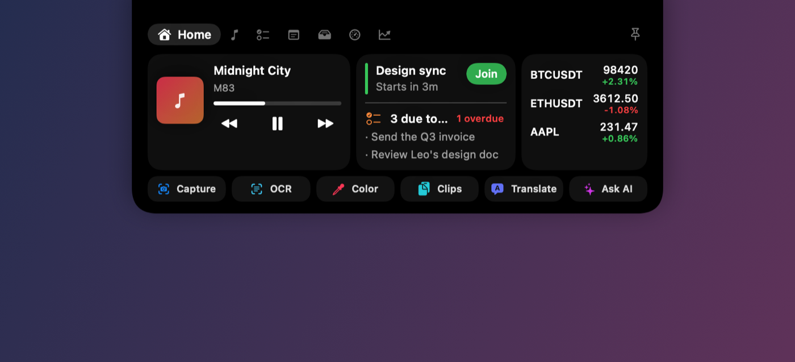
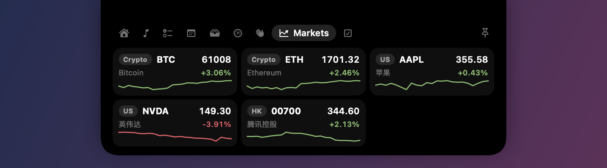
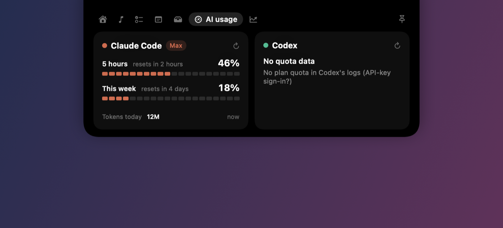
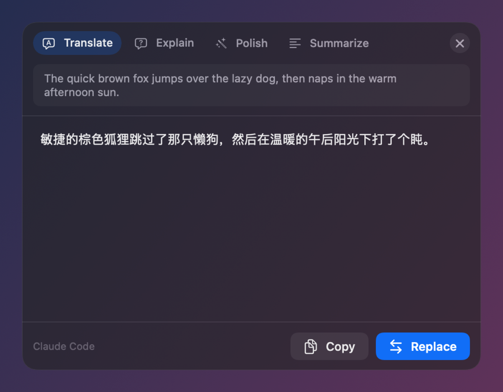
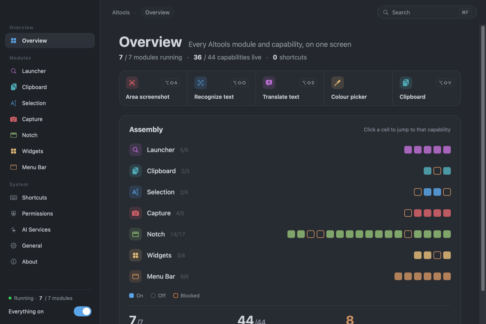
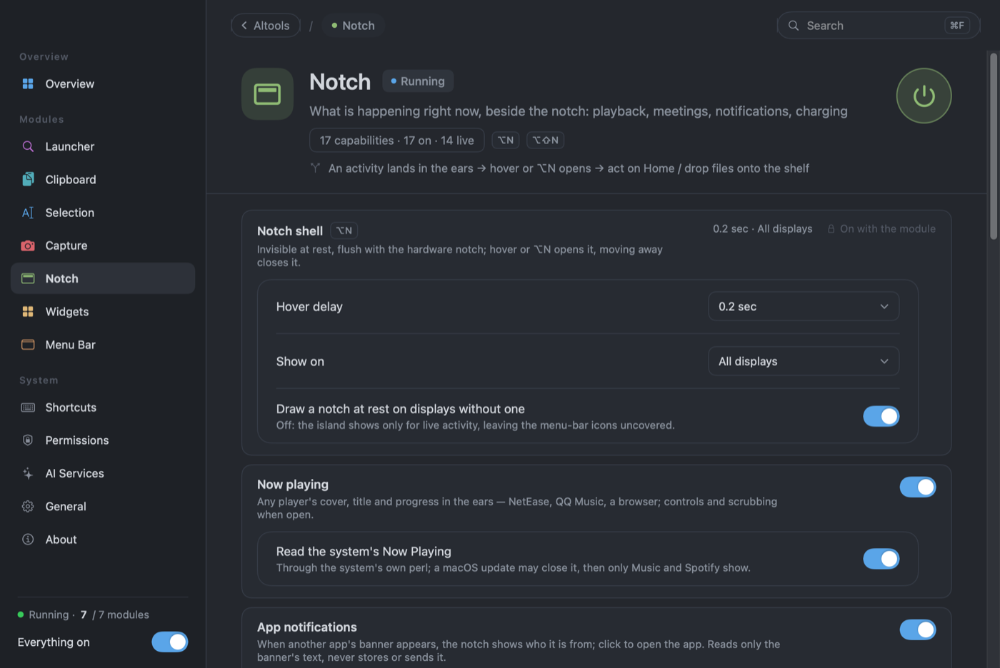

# Altools

**English** · [简体中文](README.zh-CN.md) · [Homepage — try it in the browser](https://matyle.github.io/altools/)

A native macOS menu-bar toolkit: a launcher with clipboard history and AI, actions on selected text, screenshots with annotation and OCR, a notch island with live activity, menu-bar widgets, and a menu-bar icon hider. Written in Swift and SwiftUI, no Electron, no account.



## Features

### Notch island
Hover the notch (or press ⌥N) for a panel with now playing, your next meeting and to-dos, a market watchlist and quick actions. While it is closed, the "ears" beside the notch show what is happening now: playback, a meeting countdown, volume, charging, camera and microphone use, finished downloads.

- **Tabs:** Home, Media, To-do (Reminders), Notes (Markdown files), Shelf (drop files), AI usage, Markets.
- **Meeting reminders:** a minute before a calendar meeting, a card drops with a countdown and a **Join** button that opens Zoom, Teams or Tencent Meeting in its app (Google Meet in the browser); the ears count down until it starts.
- **Agent alerts:** when an agent in a [tuios](https://tuios.dev/) pane needs approval, has a question, errors or finishes, a card drops from the notch; click it to jump to that pane.
- **Markets:** crypto pairs, US and Hong Kong stocks; add them by name or code.
- **AI usage:** Claude Code's 5-hour and weekly plan quotas, and tokens used today.
- **Plugins:** put your own widgets in the notch (beside it, on Home, in their own tab, as alert cards), laid out however you like, or no UI at all and just event-driven alerts, with a folder holding `plugin.json` and a script in any language. Markets ships as a built-in plugin. Describe one and Claude Code writes it for you, or see the [plugin guide](PLUGINS.md) and [examples](examples/plugins) such as TickTick / 滴答清单.
- On displays without a notch it can draw one, or show only while something is live.

| | |
|---|---|
|  |  |
|  |  |

### Launcher
⌥ Space opens one box for apps, commands, maths and clipboard history. Press ⇥ to ask AI through your local **Claude Code** or **Codex** CLI, with a chosen tool access level (none, read-only, edit files, full).

| | |
|---|---|
|  |  |

### Selected text
Select text anywhere and a small bar offers copy, search, translate, explain, rewrite or a custom prompt; the result can replace the selection.



### Capture
⌥⇧A captures an area to annotate (rectangles, arrows, highlights, text), copy, save or pin on screen. ⌥⇧O copies the text in an area (on-device OCR with Vision).


### Menu bar
- **Widgets:** CPU, battery, calendar and network speed, each opening its own panel.
- **Hide icons (macOS 27):** sort apps into Shown, Hidden or Always hidden. Hidden icons disappear. Click the entry icon, press ⌥B or rest the pointer on the empty menu bar to bring them back.

### Settings
Every module and capability can be switched on or off, and searched.

| | |
|---|---|
|  |  |

## Shortcuts

| Keys | Action |
|---|---|
| ⌥ Space | Launcher |
| ⌥⇧ Space | Ask AI |
| ⌥⇧ V | Clipboard history |
| ⌥⇧ A | Capture area and annotate |
| ⌥⇧ O | Capture text (OCR) |
| ⌥⇧ S | Actions on selected text |
| ⌥ N | Open the notch |
| ⌥⇧ N | New note |
| ⌥ B | Show hidden menu-bar icons |

## Install

1. Download `Altools.dmg` from the latest [Release](../../releases/latest); every push to `main` publishes one.
2. Open it and drag **Altools** onto **Applications**, then open Altools from Applications. Builds are not notarised: if macOS says it can't check the app, open **System Settings › Privacy & Security** and click **Open Anyway**.
3. Grant what you use when asked: **Accessibility** (selected text, paste-back, hotkeys, listing menu-bar icons), **Screen Recording** (capture), Calendar and Reminders (notch), Automation (Music and Spotify).

Run it from /Applications: macOS 27 refuses menu-bar items from apps running elsewhere, such as a build folder.

Requires macOS 14 or later. Hiding menu-bar icons needs macOS 27; it uses a private system framework and may stop working in a later macOS.

## Build

```sh
scripts/build-app.sh                  # build/Altools.app (release)
scripts/build-app.sh release install  # also copies it to /Applications
scripts/build-app.sh release dmg      # also makes build/Altools.dmg
swift test                            # core logic tests
```

Without a signing certificate the app is signed ad hoc, so macOS asks for permissions again after each build. Set `ALTOOLS_SIGN_IDENTITY` to a code-signing identity to keep them.

The screenshots above are rendered with demo data from a debug build:

```sh
swift build -c debug
ALTOOLS_RENDER_DIR=/tmp/altools-render "$(swift build -c debug --show-bin-path)/Altools"
```

## Privacy

- Everything runs on your Mac. Altools has no server, no analytics and no account.
- AI requests go through the Claude Code or Codex CLI you already have, with its own sign-in.
- Clipboard history stays local and skips items password managers mark as secret.
- Notification text is read to show the card and is never stored or sent.
- Network requests: market prices (Binance for crypto, Tencent's public quote service for stocks), and Claude Code's usage endpoint when you connect AI usage.
