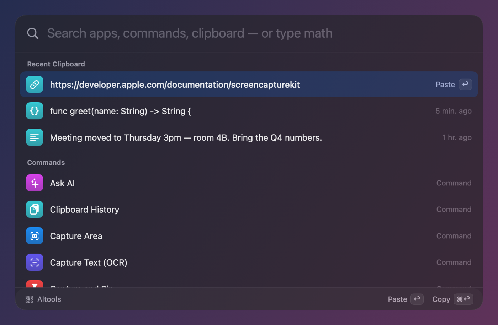
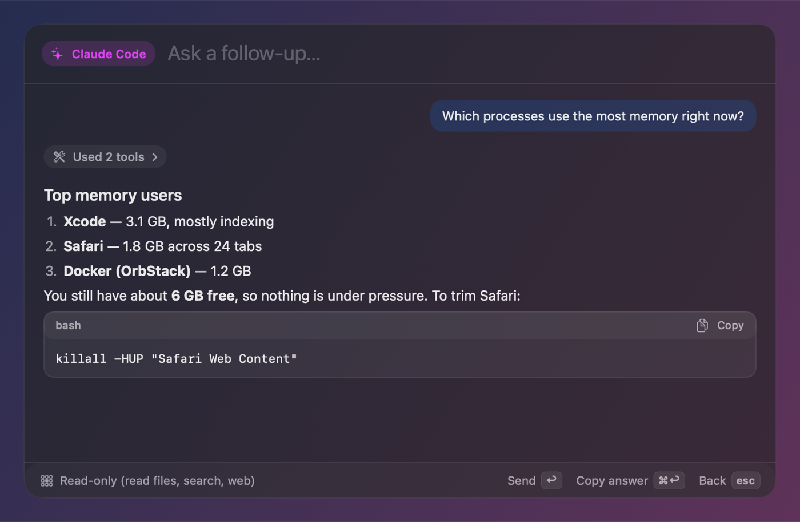
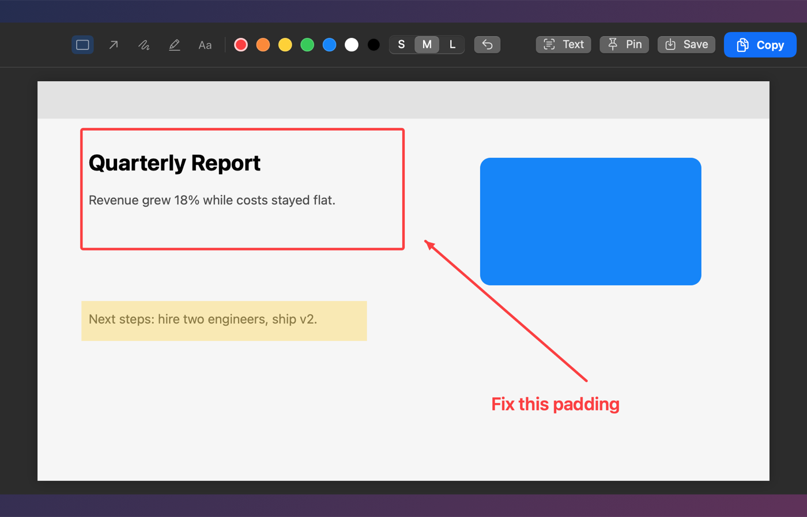

# Altools

**English** · [简体中文](README.zh-CN.md) · [Homepage — try it in the browser](https://matyle.github.io/altools/)

A native macOS menu-bar toolkit: a launcher with clipboard history and AI, actions on selected text, screenshots with annotation and OCR, a notch island with live activity, menu-bar widgets, a menu-bar icon hider, and plugins you can write in any language. Written in Swift and SwiftUI, no Electron, no account.


## Features

### Notch island
Hover the notch (or press ⌥N) for a panel with now playing, your next meeting and to-dos, a market watchlist and quick actions. While it is closed, the "ears" beside the notch show what is happening now: playback, a meeting countdown, volume, charging, camera and microphone use, finished downloads.

- **Tabs:** Home, Media, To-do (Reminders), Notes (Markdown files), Shelf (drop files), AI usage, and one for each plugin with a page.
- **Meeting reminders:** a minute before a calendar meeting, a card drops with a countdown and a **Join** button that opens Zoom, Teams or Tencent Meeting in its app (Google Meet in the browser); the ears count down until it starts.
- **Agent alerts:** when an agent in a [tuios](https://tuios.dev/) pane needs approval, has a question, errors or finishes, a card drops from the notch; click it to jump to that pane.
- **AI usage:** Claude Code's 5-hour and weekly plan quotas, and tokens used today.
- On displays without a notch it can draw one, or show only while something is live.

| | |
|---|---|
|  |  |
|  | |

### Plugins
Add your own features with a folder holding `plugin.json` and a script in any language (shell, Python, the JavaScript macOS already has, a compiled binary). Altools runs it and draws what it prints; the [plugin guide](PLUGINS.md) is the whole contract.

| Where | What a plugin can add |
|---|---|
| Notch | Short status beside the notch, a Home card, its own tab, alert cards |
| Menu bar | Its own item, with a panel showing the plugin's page |
| Launcher | Commands (each can have a global hotkey) and a search keyword, such as `mk` or `b64` |
| Selected text | Actions in the selection bar, whose result can replace the selection |

- **Your own layout:** plugins describe their UI as a tree of stacks, grids, cards, text, symbols, badges, progress bars and sparklines, drawn natively like a widget. Or no UI at all: a plugin can stay running and pop a card only when something happens.
- **Share:** export a plugin as an `.altoolsplugin` file, import one, or install from a GitHub folder. Settings › Plugins › **Plugin store** lists featured plugins and any repository tagged `altools-plugin`.
- **Write one with AI:** describe what you want in Settings › Plugins and Claude Code writes it, reading the same guide.
- **Built in:** Markets, with crypto, US and Hong Kong stocks added by name or code, sparklines, a launcher search (`mk 腾讯`) and an optional menu-bar ticker.
- **Examples:** [text tools](examples/plugins/text-tools), [site monitor](examples/plugins/site-monitor) and [more](examples/plugins).


### Launcher
⌥ Space opens one box for apps, commands, maths and clipboard history. Press ⇥ to ask AI through your local **Claude Code** or **Codex** CLI, with a chosen tool access level (none, read-only, edit files, full).

| | |
|---|---|
|  |  |

### Selected text
Select text anywhere and a small bar offers copy, search, translate, explain, rewrite or a custom prompt; the result can replace the selection.


### Capture
⌥⇧A captures an area to annotate (rectangles, arrows, highlights, text), copy, save or pin on screen. ⌥⇧O copies the text in an area (on-device OCR with Vision).



### Menu bar
- **Widgets:** CPU, battery, calendar and network speed, each opening its own panel.
- **Hide icons (macOS 27):** sort apps into Shown, Hidden or Always hidden. Hidden icons disappear. Click the entry icon, press ⌥B or rest the pointer on the empty menu bar to bring them back.

### Settings
Every module and capability can be switched on or off, and searched.

| | |
|---|---|
|  |  |

## Shortcuts

| Keys | Action |
|---|---|
| ⌥ Space | Launcher |
| ⌥⇧ Space | Ask AI |
| ⌥⇧ V | Clipboard history |
| ⌥⇧ A | Capture area and annotate |
| ⌥⇧ O | Capture text (OCR) |
| ⌥⇧ S | Actions on selected text |
| ⌥ N | Open the notch |
| ⌥⇧ N | New note |
| ⌥ B | Show hidden menu-bar icons |

## Install

1. Download `Altools.dmg` from the latest [Release](../../releases/latest); every push to `main` publishes one.
2. Open it and drag **Altools** onto **Applications**, then open Altools from Applications. Builds are not notarised: if macOS says it can't check the app, open **System Settings › Privacy & Security** and click **Open Anyway**.
3. Grant what you use when asked: **Accessibility** (selected text, paste-back, hotkeys, listing menu-bar icons), **Screen Recording** (capture), Calendar and Reminders (notch), Automation (Music and Spotify).

Run it from /Applications: macOS 27 refuses menu-bar items from apps running elsewhere, such as a build folder.

Requires macOS 14 or later. Hiding menu-bar icons needs macOS 27; it uses a private system framework and may stop working in a later macOS.

## Build

```sh
scripts/build-app.sh                  # build/Altools.app (release)
scripts/build-app.sh release install  # also copies it to /Applications
scripts/build-app.sh release dmg      # also makes build/Altools.dmg
swift test                            # core logic tests
```

Without a signing certificate the app is signed ad hoc, so macOS asks for permissions again after each build. Set `ALTOOLS_SIGN_IDENTITY` to a code-signing identity to keep them.

The screenshots above are rendered with demo data from a debug build:

```sh
swift build -c debug
ALTOOLS_RENDER_DIR=/tmp/altools-render "$(swift build -c debug --show-bin-path)/Altools"
```

## Privacy

- Everything runs on your Mac. Altools has no server, no analytics and no account.
- AI requests go through the Claude Code or Codex CLI you already have, with its own sign-in.
- Clipboard history stays local and skips items password managers mark as secret.
- Notification text is read to show the card and is never stored or sent.
- Network requests: the Markets plugin's prices (Binance for crypto, Tencent's public quote service and Yahoo Finance for stocks), and Claude Code's usage endpoint when you connect AI usage.
- Plugins run on your Mac with your permissions and make only the requests their scripts make; install ones you trust. Secret plugin settings are kept in the Keychain.
