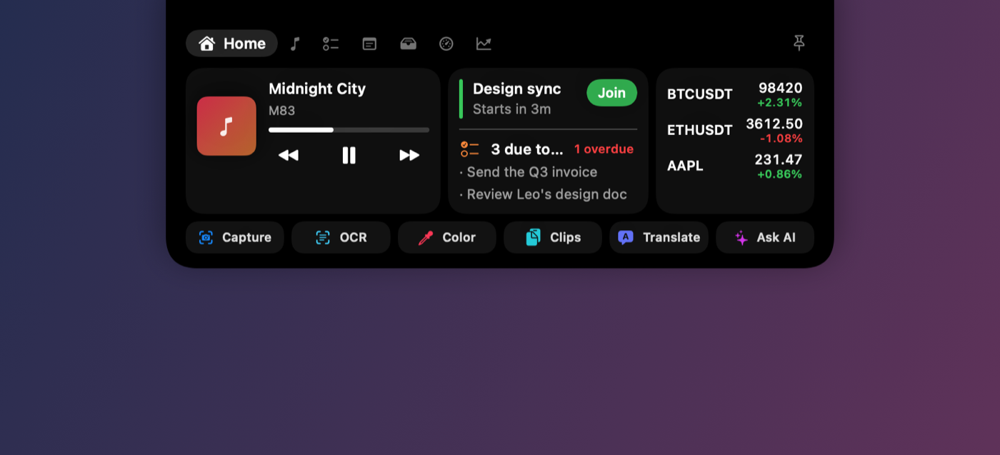
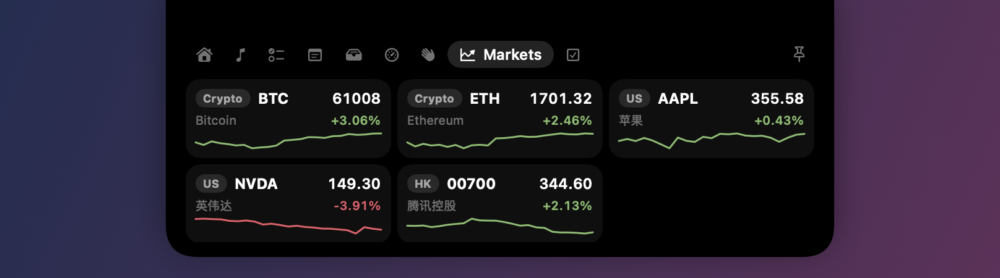
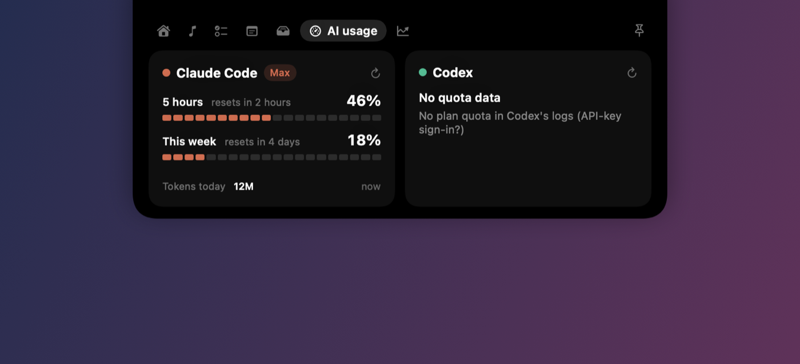
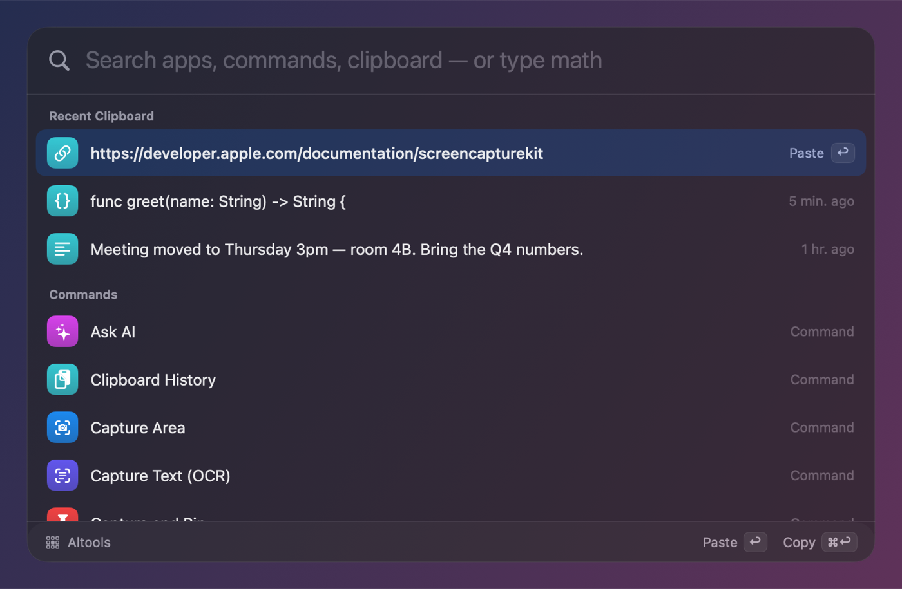
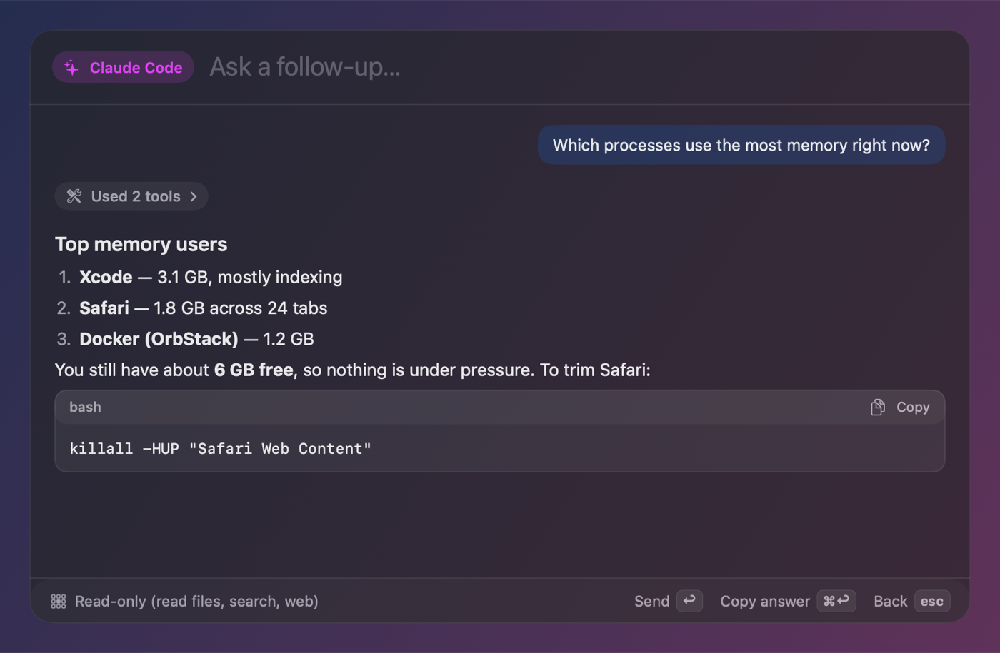
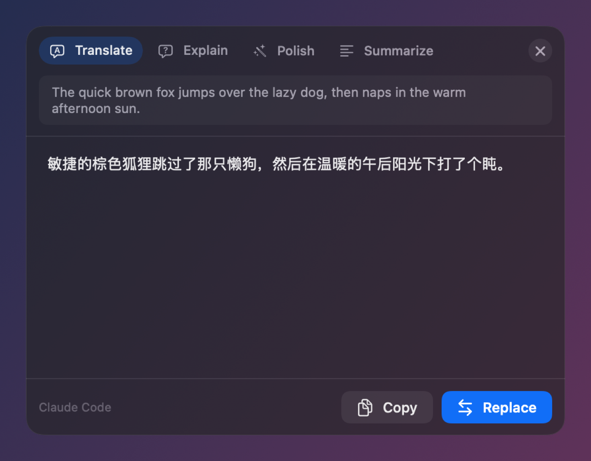
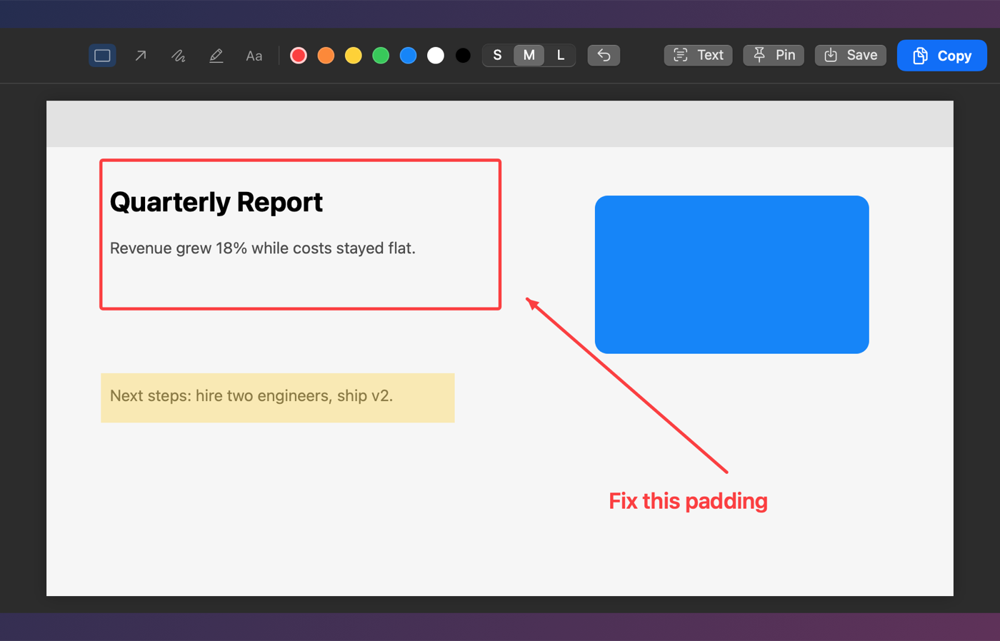
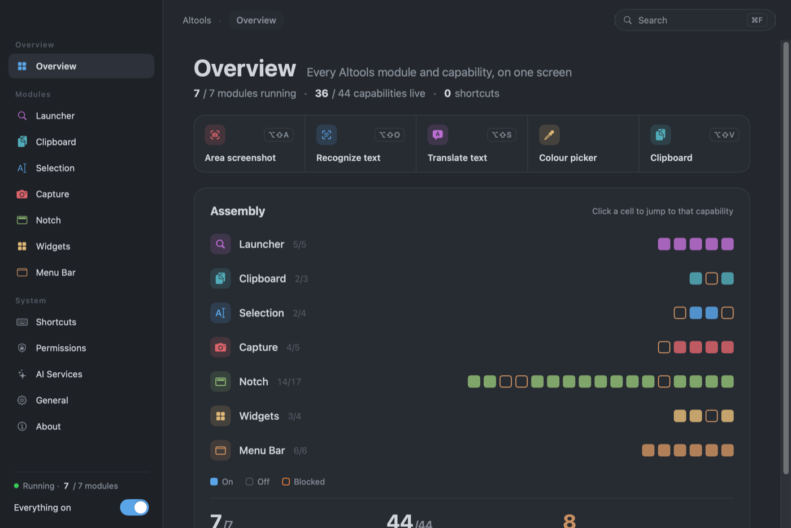
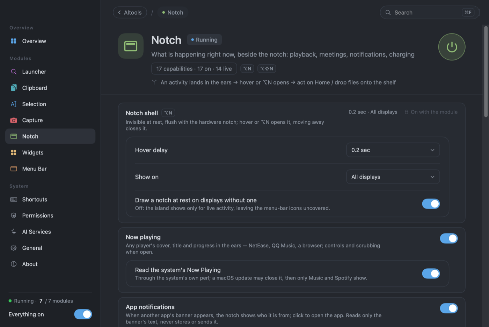

# Altools

[English](README.md) · **简体中文** · [主页：在浏览器里试用](https://matyle.github.io/altools/)

一个原生的 macOS 菜单栏工具箱：带剪贴板历史和 AI 的启动器、划词操作、带标注和文字识别的截图、显示实时动态的刘海岛、菜单栏小组件，以及菜单栏图标隐藏。用 Swift 和 SwiftUI 编写，不是 Electron，也不需要注册账号。



## 功能

### 刘海岛
鼠标停在刘海上（或按 ⌥N）会展开一个面板：正在播放、下一个会议和待办、行情自选、快捷操作。收起时，刘海两侧的"耳朵"显示当下正在发生的事：播放、会议倒计时、音量、充电、摄像头和麦克风占用、下载完成。

- **标签页：** 主页、媒体、待办（提醒事项）、笔记（Markdown 文件）、暂存架（拖入文件）、AI 用量、行情。
- **会议提醒：** 日历里的会议开始前一分钟，刘海弹出卡片，带倒计时和 **加入** 按钮，直接用 App 打开 Zoom、Teams 或腾讯会议（Google Meet 用浏览器打开）；开始前两侧耳朵一直倒计时。
- **Agent 提醒：** [tuios](https://tuios.dev/) 里的 agent 需要你批准、有问题要问、出错或完成一轮时，刘海会弹出卡片；点一下直接跳到那个面板。
- **行情：** 加密货币、美股、港股，可以按名称或代码添加。
- **AI 用量：** Claude Code 套餐的 5 小时和每周额度，以及今天用掉的 token。
- 没有刘海的显示器上可以画一个，也可以只在有动态时出现。

| | |
|---|---|
|  |  |
|  |  |

### 启动器
⌥ Space 打开一个输入框，搜应用、命令、算式和剪贴板历史。按 ⇥ 通过你本机的 **Claude Code** 或 **Codex** CLI 提问，可以选择工具权限（无、只读、可改文件、完全）。

| | |
|---|---|
|  |  |

### 划词
在任何地方选中文字，会出现一个小工具条：复制、搜索、翻译、解释、改写或自定义提示词；结果可以直接替换选中的文字。



### 截图
⌥⇧A 截取区域后标注（矩形、箭头、高亮、文字），再复制、保存或钉在屏幕上。⌥⇧O 直接复制区域里的文字（用系统 Vision 在本机识别）。



### 菜单栏
- **小组件：** CPU、电池、日历、网速，点开各有面板。
- **隐藏图标（macOS 27）：** 把每个 app 放进"显示""隐藏"或"始终隐藏"。隐藏的图标会消失；点入口图标、按 ⌥B，或把鼠标停在菜单栏空白处，就能把它们叫回来。

### 设置
每个模块和功能都可以单独开关，也可以搜索。

| | |
|---|---|
|  |  |

## 快捷键

| 按键 | 作用 |
|---|---|
| ⌥ Space | 启动器 |
| ⌥⇧ Space | 问 AI |
| ⌥⇧ V | 剪贴板历史 |
| ⌥⇧ A | 截图并标注 |
| ⌥⇧ O | 截图识别文字 |
| ⌥⇧ S | 对选中文字操作 |
| ⌥ N | 打开刘海 |
| ⌥⇧ N | 新建笔记 |
| ⌥ B | 显示隐藏的菜单栏图标 |

## 安装

1. 从最新的 [Release](../../releases/latest) 下载 `Altools.dmg`；每次推送到 `main` 都会自动发布一个。
2. 打开后把 **Altools** 拖到 **应用程序（Applications）**，再从应用程序里打开它。安装包没有经过公证：如果 macOS 提示无法验证，打开 **系统设置 › 隐私与安全性**，点 **仍要打开**。
3. 按需授予权限：**辅助功能**（划词、粘贴回去、快捷键、读取菜单栏图标）、**屏幕录制**（截图）、日历和提醒事项（刘海）、自动化（Music 和 Spotify）。

请从 /Applications 运行：macOS 27 会拒绝从其他位置（比如构建目录）运行的 app 的菜单栏图标。

需要 macOS 14 或更高版本。隐藏菜单栏图标需要 macOS 27；它用到系统的私有框架，以后的 macOS 可能会让它失效。

## 构建

```sh
scripts/build-app.sh                  # 生成 build/Altools.app（release）
scripts/build-app.sh release install  # 同时复制到 /Applications
scripts/build-app.sh release dmg      # 同时生成 build/Altools.dmg
swift test                            # 核心逻辑测试
```

没有签名证书时，app 使用临时签名（ad hoc），每次构建后 macOS 都会重新要权限。把 `ALTOOLS_SIGN_IDENTITY` 设成一个代码签名身份就能保留权限。

上面的截图都是 debug 构建用演示数据渲染的：

```sh
swift build -c debug
ALTOOLS_RENDER_DIR=/tmp/altools-render "$(swift build -c debug --show-bin-path)/Altools"
```

## 隐私

- 一切都在你的 Mac 上运行。Altools 没有服务器、没有统计、不需要账号。
- AI 请求走你本机已有的 Claude Code 或 Codex CLI，用它们自己的登录。
- 剪贴板历史只存在本地，并跳过密码管理器标记为机密的内容。
- 通知的文字只用来显示卡片，不会保存或发送。
- 会发出的网络请求：行情（加密货币来自 Binance，股票来自腾讯公开行情接口）；连接 AI 用量后访问 Claude Code 的用量接口。
